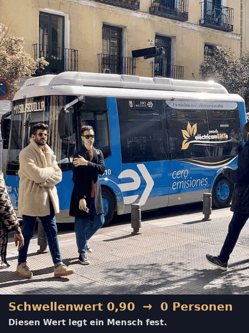
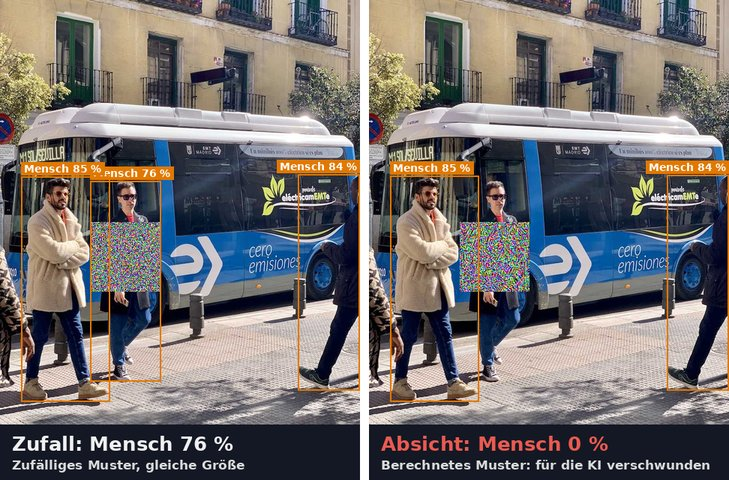

# Automatisiertes Fahren! Sicher durch Zufall?

Workshop- und Lehrmaterial zur Wahrnehmung automatisierter Fahrzeuge 
Hochschule Kempten, Institut für Fahrerassistenz und vernetzte Mobilität (IFM) · Milin Patel

---

Automatisierte Fahrzeuge erkennen Personen mit Kameras und KI-Modellen. Ein solches Modell liefert keine Gewissheit,
sondern für jede mögliche Person eine Zahl, die **Konfidenz**. Ab welchem Wert eine Erkennung zählt, der **Schwellenwert**,
legt ein Mensch fest.

Die Animation zeigt dasselbe Bild mit demselben Modell. Nur der Schwellenwert ändert sich:
Bei 0,90 wird keine Person erkannt, bei 0,20 alle vier, bei 0,05 entstehen Fehlalarme.

Dieses Repository enthält das Notebook des Workshops *Automatisiertes Fahren! Sicher durch Zufall?* (Campustage 2026),
ein Vertiefungs-Notebook und weiterführendes Kursmaterial.

 

## Workshop-Notebook: Der KI-Blick

Mit einem echten Objekterkennungsmodell (YOLOv8n) wird untersucht, wann eine Person erkannt wird und wann nicht.

| Teil | Inhalt |
|---|---|
| 1 · Bild und Referenz | Bild wählen (Beispielbild oder eigenes Foto), Personen selbst zählen |
| 2 · Objekterkennung | Erkennungen, Konfidenz und verworfene Kandidaten |
| 3 · Schwellenwert | Den eigenen Arbeitspunkt festlegen, Zielkonflikt zwischen übersehenen Personen und Fehlalarmen |
| 4 · Schlechte Sicht | Nebel, Regen und Dunkelheit als auslösende Bedingungen; Schwellenwert senken oder Einsatzbereich begrenzen |
| 5 · Zufall oder Absicht | Verdeckung durch ein Zufallsmuster im Vergleich zu einem gezielten Angriff |
| Abschluss | Ergebnis, Fachbegriffe, weiterführendes Material |

- **Dauer:** etwa 20 bis 25 Minuten, keine Vorkenntnisse nötig
- **Bedienung:** im Browser über Google Colab, ohne Installation; im Menü *Laufzeit → Alle ausführen*, danach Schaltflächen und Regler
- **Voraussetzung:** ein Google-Konto

## Vertiefung: Sicher durch Zufall? Wie viel Testen reicht?

Was sagen zufällige Tests über die Sicherheit eines Systems aus? Das Notebook prüft das Modell in vielen zufälligen
Sichtbedingungen, erläutert mit der Dreierregel, warum null Fehler keine Sicherheit belegen, und sucht Grenzfälle systematisch.
Etwa 10 Minuten.

## Zufall oder Absicht

Ein Zufallsmuster verdeckt einen Teil der Person, die Konfidenz sinkt leicht (0,76).
Ein gezielt berechnetes Muster gleicher Größe senkt sie unter den Schwellenwert (0,12): Die Person wird nicht mehr erkannt.
Zufällige Störungen und gezielte Angriffe sind unterschiedliche Probleme und werden unterschiedlich abgesichert.

## Kursmaterial

Die folgenden 34 Notebooks stammen aus einem Kurs zu Sicherheit und Security des automatisierten Fahrens.
Sie sind englischsprachig, setzen Programmierkenntnisse voraus und entsprechen dem Niveau eines Bachelor- oder Masterstudiums.

**01 · Perception Systems**

| Notebook | Thema | |
|---|---|---|
| `01_sae_automation_levels` | Introduction & SAE Levels of Driving Automation | [Colab](https://colab.research.google.com/github/milinpatel07/campustage-2026-sicher-durch-zufall/blob/main/01_Perception_Systems/notebooks/01_sae_automation_levels.ipynb) |
| `02_sensor_technologies` | Sensor Modalities in Autonomous Vehicles | [Colab](https://colab.research.google.com/github/milinpatel07/campustage-2026-sicher-durch-zufall/blob/main/01_Perception_Systems/notebooks/02_sensor_technologies.ipynb) |
| `03_object_detection` | Object Detection Demo with YOLOv8 | [Colab](https://colab.research.google.com/github/milinpatel07/campustage-2026-sicher-durch-zufall/blob/main/01_Perception_Systems/notebooks/03_object_detection.ipynb) |
| `04_sensor_fusion` | Sensor Fusion Basics for Autonomous Vehicles | [Colab](https://colab.research.google.com/github/milinpatel07/campustage-2026-sicher-durch-zufall/blob/main/01_Perception_Systems/notebooks/04_sensor_fusion.ipynb) |
| `05_pedestrian_detection` | Pedestrian Detection - A Safety-Critical Case Study | [Colab](https://colab.research.google.com/github/milinpatel07/campustage-2026-sicher-durch-zufall/blob/main/01_Perception_Systems/notebooks/05_pedestrian_detection.ipynb) |
| `06_lidar_sensor_fundamentals` | LiDAR Sensor Fundamentals | [Colab](https://colab.research.google.com/github/milinpatel07/campustage-2026-sicher-durch-zufall/blob/main/01_Perception_Systems/notebooks/06_lidar_sensor_fundamentals.ipynb) |
| `07_dataset_overview` | Autonomous Driving Dataset Exploration | [Colab](https://colab.research.google.com/github/milinpatel07/campustage-2026-sicher-durch-zufall/blob/main/01_Perception_Systems/notebooks/07_dataset_overview.ipynb) |

**02 · Failure Analysis**

| Notebook | Thema | |
|---|---|---|
| `01_av_failure_case_studies` | Real-World AV Failure Case Studies | [Colab](https://colab.research.google.com/github/milinpatel07/campustage-2026-sicher-durch-zufall/blob/main/02_Failure_Analysis/notebooks/01_av_failure_case_studies.ipynb) |
| `02_ood_detection` | Out-of-Distribution (OOD) Detection | [Colab](https://colab.research.google.com/github/milinpatel07/campustage-2026-sicher-durch-zufall/blob/main/02_Failure_Analysis/notebooks/02_ood_detection.ipynb) |
| `03_corner_cases_edge_cases` | Corner Cases and Edge Cases in Autonomous Driving | [Colab](https://colab.research.google.com/github/milinpatel07/campustage-2026-sicher-durch-zufall/blob/main/02_Failure_Analysis/notebooks/03_corner_cases_edge_cases.ipynb) |
| `04_adversarial_attacks` | Adversarial Attacks on AV Perception Systems | [Colab](https://colab.research.google.com/github/milinpatel07/campustage-2026-sicher-durch-zufall/blob/main/02_Failure_Analysis/notebooks/04_adversarial_attacks.ipynb) |

**03 · Functional Safety (ISO 26262)**

| Notebook | Thema | |
|---|---|---|
| `01_iso_26262_fundamentals` | ISO 26262: Functional Safety for Road Vehicles | [Colab](https://colab.research.google.com/github/milinpatel07/campustage-2026-sicher-durch-zufall/blob/main/03_Functional_Safety/notebooks/01_iso_26262_fundamentals.ipynb) |
| `02_hara_methodology` | Hazard Analysis and Risk Assessment (HARA) | [Colab](https://colab.research.google.com/github/milinpatel07/campustage-2026-sicher-durch-zufall/blob/main/03_Functional_Safety/notebooks/02_hara_methodology.ipynb) |
| `03_fmea_analysis` | FMEA for Autonomous Vehicle Systems | [Colab](https://colab.research.google.com/github/milinpatel07/campustage-2026-sicher-durch-zufall/blob/main/03_Functional_Safety/notebooks/03_fmea_analysis.ipynb) |
| `04_verification_validation` | Verification and Validation for Functional Safety | [Colab](https://colab.research.google.com/github/milinpatel07/campustage-2026-sicher-durch-zufall/blob/main/03_Functional_Safety/notebooks/04_verification_validation.ipynb) |

**04 · SOTIF (ISO 21448)**

| Notebook | Thema | |
|---|---|---|
| `01_sotif_fundamentals` | ISO 21448: Safety of the Intended Functionality (SOTIF) | [Colab](https://colab.research.google.com/github/milinpatel07/campustage-2026-sicher-durch-zufall/blob/main/04_SOTIF/notebooks/01_sotif_fundamentals.ipynb) |
| `02_scenario_analysis` | SOTIF Scenario Analysis and Triggering Conditions | [Colab](https://colab.research.google.com/github/milinpatel07/campustage-2026-sicher-durch-zufall/blob/main/04_SOTIF/notebooks/02_scenario_analysis.ipynb) |
| `03_ood_detection_sotif` | Out-of-Distribution Detection for SOTIF | [Colab](https://colab.research.google.com/github/milinpatel07/campustage-2026-sicher-durch-zufall/blob/main/04_SOTIF/notebooks/03_ood_detection_sotif.ipynb) |
| `04_simulation_sotif_validation` | Simulation-Based SOTIF Validation | [Colab](https://colab.research.google.com/github/milinpatel07/campustage-2026-sicher-durch-zufall/blob/main/04_SOTIF/notebooks/04_simulation_sotif_validation.ipynb) |

**05 · Cybersecurity (ISO/SAE 21434)**

| Notebook | Thema | |
|---|---|---|
| `01_automotive_cybersecurity` | ISO/SAE 21434: Automotive Cybersecurity Engineering | [Colab](https://colab.research.google.com/github/milinpatel07/campustage-2026-sicher-durch-zufall/blob/main/05_Cybersecurity/notebooks/01_automotive_cybersecurity.ipynb) |
| `02_tara_methodology` | Threat Analysis and Risk Assessment (TARA) | [Colab](https://colab.research.google.com/github/milinpatel07/campustage-2026-sicher-durch-zufall/blob/main/05_Cybersecurity/notebooks/02_tara_methodology.ipynb) |
| `03_attack_surface_analysis` | Attack Surface Analysis for Autonomous Vehicles | [Colab](https://colab.research.google.com/github/milinpatel07/campustage-2026-sicher-durch-zufall/blob/main/05_Cybersecurity/notebooks/03_attack_surface_analysis.ipynb) |

**06 · AI Safety**

| Notebook | Thema | |
|---|---|---|
| `01_ai_safety_standards` | ISO/PAS 8800 Series: AI Safety for Autonomous Systems | [Colab](https://colab.research.google.com/github/milinpatel07/campustage-2026-sicher-durch-zufall/blob/main/06_AI_Safety/notebooks/01_ai_safety_standards.ipynb) |
| `02_uncertainty_types` | Uncertainty Types in Deep Learning | [Colab](https://colab.research.google.com/github/milinpatel07/campustage-2026-sicher-durch-zufall/blob/main/06_AI_Safety/notebooks/02_uncertainty_types.ipynb) |
| `03_mc_dropout_ensembles` | Monte Carlo Dropout and Deep Ensembles | [Colab](https://colab.research.google.com/github/milinpatel07/campustage-2026-sicher-durch-zufall/blob/main/06_AI_Safety/notebooks/03_mc_dropout_ensembles.ipynb) |
| `04_calibration_reliability` | Calibration and Reliability | [Colab](https://colab.research.google.com/github/milinpatel07/campustage-2026-sicher-durch-zufall/blob/main/06_AI_Safety/notebooks/04_calibration_reliability.ipynb) |
| `05_safety_validation_testing` | Safety Validation and Testing for AV Perception | [Colab](https://colab.research.google.com/github/milinpatel07/campustage-2026-sicher-durch-zufall/blob/main/06_AI_Safety/notebooks/05_safety_validation_testing.ipynb) |

**07 · Integration and Deployment**

| Notebook | Thema | |
|---|---|---|
| `01_v2x_communication` | V2X Communication and Cooperative Perception | [Colab](https://colab.research.google.com/github/milinpatel07/campustage-2026-sicher-durch-zufall/blob/main/07_Integration_Deployment/notebooks/01_v2x_communication.ipynb) |
| `02_explainability_xai` | Explainability (XAI) for Safety Certification | [Colab](https://colab.research.google.com/github/milinpatel07/campustage-2026-sicher-durch-zufall/blob/main/07_Integration_Deployment/notebooks/02_explainability_xai.ipynb) |
| `03_standards_integration` | Standards Integration - How ISO 26262, 21448, and 21434 Work Together | [Colab](https://colab.research.google.com/github/milinpatel07/campustage-2026-sicher-durch-zufall/blob/main/07_Integration_Deployment/notebooks/03_standards_integration.ipynb) |
| `04_industry_deployment` | Industry Deployment Challenges - Why Level 4/5 AVs Are Not Deployed Widely | [Colab](https://colab.research.google.com/github/milinpatel07/campustage-2026-sicher-durch-zufall/blob/main/07_Integration_Deployment/notebooks/04_industry_deployment.ipynb) |
| `05_odd_runtime_monitoring` | ODD Definition and Runtime Monitoring | [Colab](https://colab.research.google.com/github/milinpatel07/campustage-2026-sicher-durch-zufall/blob/main/07_Integration_Deployment/notebooks/05_odd_runtime_monitoring.ipynb) |
| `06_standards_gaps` | Standards Gaps and Open Problems in AV Safety | [Colab](https://colab.research.google.com/github/milinpatel07/campustage-2026-sicher-durch-zufall/blob/main/07_Integration_Deployment/notebooks/06_standards_gaps.ipynb) |
| `07_regulations_type_approval` | Automotive Regulations and Type Approval | [Colab](https://colab.research.google.com/github/milinpatel07/campustage-2026-sicher-durch-zufall/blob/main/07_Integration_Deployment/notebooks/07_regulations_type_approval.ipynb) |

Vorlagen für Analysen nach ISO 26262 (HARA), ISO 21448 (SOTIF) und ISO/SAE 21434 (TARA) liegen im Ordner `templates/`.

## Für Lehrkräfte

Lernziel, Ablauf, Hinweise zu Vereinfachungen und Fragen für die Nachbesprechung:
**[fuer_lehrkraefte/README.md](fuer_lehrkraefte/README.md)**

## Technik

Die Notebooks laufen in Google Colab. Das Workshop- und das Vertiefungs-Notebook benötigen nur die Pakete
`ultralytics==8.4.216` und `matplotlib`, die automatisch installiert werden, und laufen ohne GPU.
Für das Kursmaterial lokal: `pip install -r requirements.txt`.

## Lizenz und Quellen

- Code und Texte: MIT-Lizenz, siehe `LICENSE`. © 2025–2026 Milin Patel, Hochschule Kempten (IFM).
- Das Beispielbild ist das Testbild `bus.jpg` aus dem Paket [Ultralytics](https://github.com/ultralytics/ultralytics) (AGPL-3.0).
  Die Bilder in `assets/` zeigen Ergebnisse der Notebooks auf diesem Bild und fallen nicht unter die MIT-Lizenz dieses Repositorys.
- Das Modell YOLOv8 und die Bibliothek Ultralytics stehen unter der AGPL-3.0.
- Literatur:
  - Eykholt, K. et al. (2018). Robust Physical-World Attacks on Deep Learning Visual Classification. *CVPR 2018*, 1625–1634. https://doi.org/10.1109/CVPR.2018.00175
  - Thys, S., Van Ranst, W., Goedemé, T. (2019). Fooling Automated Surveillance Cameras: Adversarial Patches to Attack Person Detection. *CVPR Workshops 2019*. https://doi.org/10.1109/CVPRW.2019.00012
  - Hanley, J. A., Lippman-Hand, A. (1983). If Nothing Goes Wrong, Is Everything All Right? Interpreting Zero Numerators. *JAMA*, 249(13), 1743–1745. https://doi.org/10.1001/jama.1983.03330370053031

---

*English: Teaching material on how automated vehicles perceive people. A no-code Colab notebook in German (detection threshold,
simulated poor visibility, adversarial patch), a follow-up notebook on testing and the rule of three, and 34 English course
notebooks on perception, functional safety, SOTIF, cybersecurity and AI safety.*
