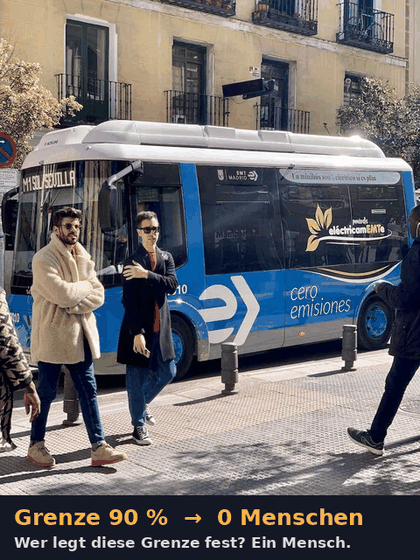

# Automatisiertes Fahren! Sicher durch Zufall?

**Campustage 2026 · Hochschule Kempten** 
Milin Patel · Institut für Fahrerassistenz und vernetzte Mobilität (IFM)

---

## Ein Auto sieht keinen Menschen. Es sieht eine Zahl.

Dasselbe Bild, dieselbe KI. Nur eine Zahl ändert sich: die **Grenze**, ab der die KI etwas als Mensch zählt.
Bei 90 % sieht das Auto niemanden. Bei 20 % alle vier. Bei 5 % sieht es sogar ein Fahrrad, wo keins ist.

**Wer stellt diese Grenze ein?** Nicht die KI. Ein Mensch.

Drei Fragen, die du in 25 Minuten selbst beantwortest:

- Wann übersieht ein Auto einen Menschen, und wer ist dann schuld?
- Was macht der KI mehr zu schaffen: Nebel, Regen oder Dunkelheit?
- Kann ein Aufkleber einen Menschen für die KI unsichtbar machen?

 

## Start hier

Du bist das Entwicklungsteam, du stellst die Regler ein,
und am Ende entscheidest du, ob dein Auto auf die Straße darf.

1. Auf **Open in Colab** klicken und mit einem Google-Konto anmelden.
2. Im Menü **Laufzeit → Alle ausführen** wählen.
3. Warten, bis **Bereit** erscheint. Danach geht alles über Knöpfe und Regler. Code lesen musst du nicht.

Dauer: etwa 25 Minuten. Vorwissen: keins.

### Deine sieben Missionen

| | Mission | Darum geht's |
|---|---|---|
| 1 | Wodurch schaut dein Auto? | Beispielbild oder euer Foto aus der Roboter-Kamera |
| 2 | Zähl-Duell | Du zählst gegen die Uhr, dann die KI |
| 3 | Die KI schaut hin | Was die KI erkennt und was sie nur vermutet |
| 4 | Du stellst die Grenze ein | Übersehen oder grundlos bremsen? Du entscheidest. |
| 5 | Die Welt ist nicht sauber | Nebel, Regen, Dunkelheit |
| 6 | Kann man die KI austricksen? | Zufälliger gegen berechneten Aufkleber |
| 7 | Mensch oder KI | Wer sieht was besser? |
| | Finale | Sicher durch Zufall? Und: Darf dein Auto fahren? |

### Zufall oder Absicht?

Ein zufälliges Muster lässt die KI kalt. Ein berechnetes Muster gleicher Größe lässt den Menschen für sie verschwinden.
Daher der Titel: **Sicher durch Zufall?** Nein. Sicher durch Menschen, die mit Zufall *und* Absicht rechnen.

### Profi-Wörter

Unterwegs schaltest du neun Begriffe frei, die Fachleute wirklich benutzen. Die meisten sind englisch, so wie in der Forschung:

`Confidence` · `Bounding Box` · `Threshold` · `False Negative` · `False Positive` · `ODD` · `Adversarial Attack` · `Sensor Fusion` · `Safety & Security`

---

## Bonus-Level

Du willst weitermachen? Zwei Notebooks als nächster Schritt (auf Englisch, mit mehr Code):

- [Pedestrian Detection](https://colab.research.google.com/github/milinpatel07/campustage-2026-sicher-durch-zufall/blob/main/01_Perception_Systems/notebooks/05_pedestrian_detection.ipynb): Fußgänger erkennen, genauer betrachtet
- [Adversarial Attacks](https://colab.research.google.com/github/milinpatel07/campustage-2026-sicher-durch-zufall/blob/main/02_Failure_Analysis/notebooks/04_adversarial_attacks.ipynb): die Fortsetzung von Mission 6

<b>Und dahinter? Über 30 weitere Notebooks</b> (aufklappen)

Diese Sammlung ist für Studium und Forschung gedacht. Vieles davon begegnet dir im Informatik-Studium wieder,
im Bachelor und noch tiefer im Master. Stöbern ausdrücklich erlaubt.

| Ordner | Thema |
|---|---|
| `01_Perception_Systems` | Wie Autos ihre Umgebung wahrnehmen: Kamera, LiDAR, Sensorfusion, Datensätze |
| `02_Failure_Analysis` | Wenn es schiefgeht: echte Unfälle, Sonderfälle, Angriffe |
| `03_Functional_Safety` | Sicherheitsnorm ISO 26262: Gefahren finden und bewerten |
| `04_SOTIF` | Sicherheit, auch wenn nichts kaputt ist (ISO 21448) |
| `05_Cybersecurity` | Schutz vor Hackern (ISO/SAE 21434) |
| `06_AI_Safety` | Wie sicher ist sich eine KI wirklich? |
| `07_Integration_Deployment` | Vom Labor auf die Straße: Kommunikation, Normen, Zulassung |

---

## Für Lehrkräfte und Vortragende

Ablauf, Zeitplan, Hinweise zum Roboter, erwartete Ergebnisse und Tipps bei Problemen:
**[fuer_lehrkraefte/README.md](fuer_lehrkraefte/README.md)**

## Technisches

Das Workshop-Notebook läuft in Google Colab ohne Installation und braucht nur das Paket `ultralytics` (YOLOv8, wird automatisch installiert).
Die übrigen Notebooks benötigen weitere Pakete, siehe `requirements.txt`.

## Lizenz

MIT-Lizenz, siehe `LICENSE`. Über einen Hinweis auf die Quelle bei Nutzung im Unterricht freuen wir uns.
Das Beispielbild (Straßenszene mit Bus) ist das Testbild `bus.jpg` aus dem Paket [Ultralytics](https://github.com/ultralytics/ultralytics);
die Bilder in `assets/` zeigen echte Ergebnisse des Workshop-Notebooks darauf.

© 2026 Milin Patel, Hochschule Kempten (IFM)

---

*English: A hands-on, no-code Colab notebook (in German) for school students on how automated vehicles perceive people,
and where that perception fails: detection thresholds, simulated weather, and a computed adversarial patch.
The other folders hold English university-level material on safety and security of automated driving.*
